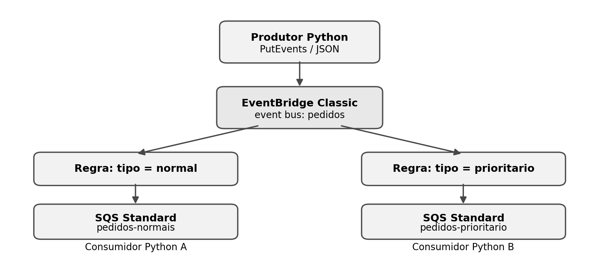
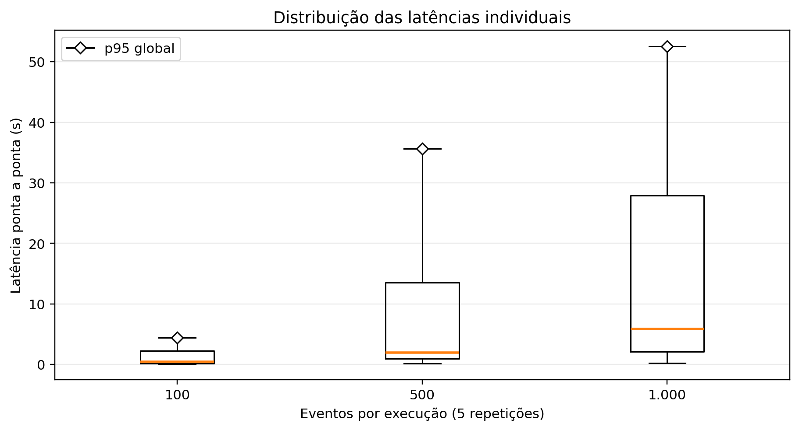

# Amazon EventBridge + Amazon SQS — avaliação experimental de middleware

Implementação acadêmica de uma arquitetura orientada a eventos na AWS real, para a disciplina de Sistemas Distribuídos. O produtor Python publica eventos `PedidoCriado`; regras no EventBridge Classic encaminham pedidos normais ou prioritários para duas filas SQS Standard. Consumidores independentes recuperam os eventos e gravam métricas para análise.



## Resultados observados — 14/11/2026

| Cenário | Eventos aceitos | Com destino esperado | Entregues corretamente |
|---|---:|---:|---:|
| Smoke | 2 | 2 | 2 |
| Roteamento (100 válidos + 10 desconhecidos) | 110 | 100 | 100 |
| Carga 100 × 5 | 500 | 500 | 500 |
| Carga 500 × 5 | 2.500 | 2.500 | 2.500 |
| Carga 1.000 × 5 | 5.000 | 5.000 | 5.000 |
| Sem consumidores por 10 segundos | 100 | 100 | 100 |
| **Total** | **8.212** | **8.202** | **8.202** |

Não foram identificadas mensagens faltantes, entregas na fila incorreta ou duplicações **dentro das janelas de observação**. Isso não estabelece uma garantia de exactly-once, nem mede isoladamente o desempenho do EventBridge.

| Eventos por execução (5 repetições) | Latência média | Mediana | p95 global | Vazão média das repetições |
|---:|---:|---:|---:|---:|
| 100 | 1,326 s | 0,411 s | 4,434 s | 20,71 eventos/s |
| 500 | 9,086 s | 1,977 s | 35,619 s | 33,16 eventos/s |
| 1.000 | 15,808 s | 5,863 s | 52,562 s | 33,04 eventos/s |

No cenário de ausência dos consumidores, os 100 eventos foram recuperados após a reativação, com 11,679 segundos de tempo de recuperação medido pelo programa. O SQS apresenta contadores de profundidade aproximados; portanto, esses contadores não devem ser tratados como valores exatos para o instante de cada amostra.



## Estrutura

```text
eventbridge-sqs-sbc/
├── README.md
├── .gitignore
├── .env.example
├── requirements.txt
├── src/
│   ├── experimentos.py          # programa de coleta, editado para remover account ID fixo
│   ├── gerar_graficos.py        # estatísticas e gráficos sem conexão à AWS
│   ├── produtor_demo.py         # exemplo funcional, separado dos experimentos
│   └── consumidor_demo.py       # consulta simples, não altera fila por padrão
├── infraestrutura/
│   ├── cloudformation.yaml      # infraestrutura equivalente (opcional; cria recursos)
│   ├── padrao_normal.json
│   ├── padrao_prioritario.json
│   └── README.md
├── dados/
│   ├── brutos/                  # 56 arquivos CSV realmente coletados na AWS
│   └── processados/             # derivados pelos scripts de análise
├── figuras/                    # 7 PNG gerados automaticamente
├── artigo/
│   ├── artigo_eventbridge_sbc.tex
│   ├── artigo_eventbridge_sbc.pdf
│   ├── sbc-template-compat.sty
│   └── README.md
└── tests/
    └── test_dados.py
```

## Recriar gráficos a partir dos dados reais (sem AWS e sem cobrança)

```bash
python -m pip install -r requirements.txt
python src/gerar_graficos.py
```

O script valida a consistência dos 18 ensaios, cruza os CSVs individuais e regenera os arquivos de `figuras/` e `dados/processados/`. O p95 por carga é calculado **sobre as mensagens individuais agregadas**, em vez da média dos p95 por execução.

Teste de integridade dos dados:

```bash
python -m unittest discover -s tests -v
```

## Reproduzir os experimentos na AWS (gera novas cobranças)

**Não é necessário executar novamente para avaliar o trabalho.** Todos os CSVs observados já estão neste repositório.

A infraestrutura original foi criada manualmente na região `us-east-2`: EventBridge Classic `pedidos`; regras `pedidos-normais` e `pedidos-prioritario`; filas Standard com os mesmos nomes. O `infraestrutura/cloudformation.yaml` é apenas uma alternativa de provisionamento para **outra conta ou região onde esses nomes não existam**; ele não foi utilizado para montar a infraestrutura medida.

Antes de qualquer publicação, configure acesso AWS legítimo (CloudShell ou perfil AWS CLI), confira as permissões, a região, o orçamento e a conta:

```bash
aws sts get-caller-identity
aws events list-event-buses --region us-east-2
```

É recomendado definir `AWS_EXPECTED_ACCOUNT_ID` **apenas no ambiente local**, para abortar caso você esteja na conta errada. Não é necessário incluir o ID no repositório.

```bash
# Linux / CloudShell
export AWS_EXPECTED_ACCOUNT_ID="<ID_DA_CONTA_QUE_VOCE_AUTORIZOU>"
```

O programa `src/experimentos.py` é a versão efetivamente usada na análise **com uma única adaptação para publicação**: a conta fixa foi substituída pela variável de ambiente opcional acima. A lógica de aquisição e cálculo permanece a mesma. O código original não cria recursos, não purga filas e não apaga mensagens de testes anteriores. Entretanto, ao consumir os eventos do próprio teste, ele chama `DeleteMessage` após registrar os dados.

Não execute dois consumidores independentes sobre essas filas durante os ensaios. Certifique-se de que ambas estão vazias antes de começar.

```bash
python src/experimentos.py --cenario smoke --saida novos_resultados
python src/experimentos.py --cenario roteamento --qtd 100 --saida novos_resultados
python src/experimentos.py --cenario carga --qtd 100 --repeticoes 5 --saida novos_resultados
python src/experimentos.py --cenario carga --qtd 500 --repeticoes 5 --saida novos_resultados
python src/experimentos.py --cenario carga --qtd 1000 --repeticoes 5 --saida novos_resultados
python src/experimentos.py --cenario indisponibilidade --qtd 100 --espera 10 --limite-entrega 180 --saida novos_resultados
```

Os testes de carga usam até 1.000 eventos por repetição e até 5 repetições; há limite interno de publicações por execução. As repetições são separadas por pausas para reduzir efeitos de contadores aproximados. O código não isola a latência interna do EventBridge.

## Método e limitações

- Comparação descritiva de 100, 500 e 1.000 eventos; cinco repetições por carga, não randomizadas.
- Dois consumidores Python executados como threads no AWS CloudShell; `ReceiveMessage` solicita até dez mensagens com `WaitTimeSeconds=2`.
- Cada mensagem contém `run_id`, `evento_id`, tipo e instante UTC de publicação.
- Latência ponta a ponta: diferença entre timestamp anterior à chamada PutEvents e timestamp no consumidor.
- Vazão de entrega por execução: IDs corretos / intervalo entre primeiro envio e último recebimento; a tabela exibe a média das cinco vazões.
- No teste de indisponibilidade, os consumidores só são iniciados após a publicação e dez segundos de ausência. Não é um teste de falha abrupta de consumidor ativo.
- A profundidade do SQS é aproximada e mostrou oscilações; veja `figuras/backlog_aproximado.png`. Para prova de entrega, utilizar os IDs únicos efetivamente recebidos.
- O protótipo não mede exatamente uma vez, ordenação, throughput máximo dos serviços ou comparação com outras plataformas.

## Publicar no GitHub

1. Revise o conteúdo (o dataset de teste possui UUIDs sintéticos; não contém credenciais AWS; os scripts não incluem account ID fixo).
2. Crie um repositório vazio no GitHub, por exemplo `eventbridge-sqs-sbc`.
3. Na pasta extraída, execute:

```bash
git init
git add .
git commit -m "Publica experimento SBC EventBridge SQS e resultados"
git branch -M main
git remote add origin https://github.com/SEU_USUARIO/eventbridge-sqs-sbc.git
git push -u origin main
```

Substitua `SEU_USUARIO` pelo seu login real. A criação do repositório remoto e a autenticação não são feitas por este pacote. Mantenha o repositório privado até revisar os arquivos e confirmar a autoria do artigo.

## Referências

- https://docs.aws.amazon.com/eventbridge/latest/userguide/eb-what-is.html
- https://docs.aws.amazon.com/eventbridge/latest/userguide/eb-use-resource-based.html
- https://docs.aws.amazon.com/AWSSimpleQueueService/latest/SQSDeveloperGuide/standard-queues.html
- https://docs.aws.amazon.com/AWSSimpleQueueService/latest/SQSDeveloperGuide/sqs-available-cloudwatch-metrics.html
